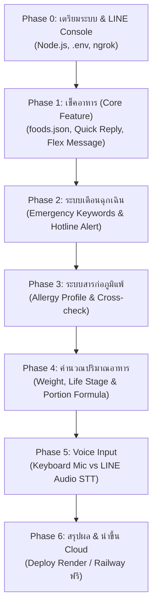

# แผนการพัฒนา LINE Bot: "Pet Food Checker" 🐾
> **โครงการต้นแบบ (MVP) รายวิชา IE414**  
> มุ่งเน้นการช่วยเจ้าของสัตว์เลี้ยง (สุนัข/แมว) ตรวจสอบความปลอดภัยของอาหาร คำนวณปริมาณอาหาร และแจ้งเตือนสารก่อภูมิแพ้ได้อย่างถูกต้อง ปลอดภัย และใช้งานได้จริง

---

## 📌 1. ภาพรวมโครงการและขอบเขตงาน (Project Overview & Scope)

### 1.1 วัตถุประสงค์
1. เป็นเครื่องมือช่วยเหลือเบื้องต้นให้เจ้าของสุนัขและแมวทราบว่าอาหารชนิดใด **"กินได้ / ต้องระวัง / ห้ามกิน"**
2. ป้องกันอันตรายฉุกเฉินด้วยระบบตรวจจับคีย์เวิร์ดวิกฤต และให้คำแนะนำติดต่อสัตวแพทย์ทันที
3. ช่วยดูแลสัตว์เลี้ยงเฉพาะตัวด้วยระบบบันทึกสารก่อภูมิแพ้ (Allergy Profile)
4. ให้แนวทางคำนวณปริมาณอาหารเบื้องต้นตามน้ำหนักและช่วงวัย
5. ออกแบบสถาปัตยกรรมระบบให้เข้าใจง่าย เป็นระเบียบ เหมาะสำหรับศึกษาและต่อยอดในเชิงวิศวกรรม

### 1.2 กฎเหล็กด้านความปลอดภัยของข้อมูล (Safety First Principle)
- **ห้าม AI คาดเดาความปลอดภัยของอาหารเองเด็ดขาด**: ข้อมูลต้องมาจากฐานข้อมูล `foods.json` ที่มีการระบุแหล่งอ้างอิง (`source`) เช่น สมาคมป้องกันการทารุณสัตว์ (ASPCA) หรือคู่มือทางสัตวแพทย์เท่านั้น
- **Fallback ปลอดภัย**: หากไม่พบชื่ออาหารในฐานข้อมูล บอทจะตอบว่า *"ยังไม่มีข้อมูลอาหารนี้ แนะนำปรึกษาสัตวแพทย์ก่อนให้น้องกิน"*
- **Medical Disclaimer**: ทุกการตอบกลับต้องมีข้อความกำกับว่า *"ข้อมูลนี้เป็นคำแนะนำเบื้องต้น ไม่สามารถทดแทนการวินิจฉัยของสัตวแพทย์"*

---

## 🏗️ 2. สถาปัตยกรรมและโครงสร้างไฟล์ของโปรเจกต์ (Project Structure)

ออกแบบให้แยกหน้าที่ชัดเจน (Separation of Concerns) เพื่อให้โค้ดอ่านง่าย แก้ไขสะดวก และส่งอาจารย์ได้มาตรฐาน:

```
project/
├── data/
│   ├── foods.json             # ฐานข้อมูลอาหาร (ชื่อ, alias, สถานะหมา/แมว, เหตุผล, source)
│   └── profiles.json          # ฐานข้อมูลจำลองสำหรับเก็บโปรไฟล์และการแพ้อาหารของผู้ใช้
├── handlers/
│   ├── eventHandler.js        # ควบคุมและกระจาย Event หลักจาก LINE Webhook
│   ├── foodHandler.js         # ตรวจสอบและค้นหาข้อมูลอาหาร พร้อมส่ง Flex Message
│   ├── emergencyHandler.js    # ดักจับคำเตือนฉุกเฉิน (เผลอกิน, ชัก, อาเจียน ฯลฯ)
│   ├── allergyHandler.js      # จัดการโปรไฟล์สารก่อภูมิแพ้ของผู้ใช้
│   └── portionHandler.js      # คำนวณปริมาณอาหารตามน้ำหนักและช่วงวัย
├── flex/
│   └── templates.js           # เทมเพลต LINE Flex Message (การ์ดแสดงผลสวยงามพร้อมป้ายสี)
├── utils/
│   ├── textMatcher.js         # ฟังก์ชันค้นหาคำแบบยืดหยุ่น (Aliases & Normalization)
│   └── calculator.js          # ฟังก์ชันคำนวณพลังงาน/ปริมาณอาหาร (RER/MER)
├── .env                       # เก็บกุญแจสำคัญ (ห้าม Push ขึ้น Git)
├── .env.example               # ตัวอย่างไฟล์การตั้งค่า Environment Variables
├── .gitignore                 # กำหนดไฟล์ที่ไม่ต้องนำขึ้น Git (node_modules, .env)
├── package.json               # รายการ Dependencies และ Scripts ของ Node.js
├── server.js                  # จุดเริ่มต้นของระบบ (Express Server + LINE Bot SDK)
└── PLAN.md                    # เอกสารแผนการทำงานฉบับนี้
```

---

## 🗓️ 3. แผนการดำเนินงานทีละเฟส (Phased Roadmap)



---

### 📋 Phase 0: การเตรียมสภาพแวดล้อมและการเชื่อมต่อ LINE Developers
**เป้าหมาย:** สร้างโปรเจกต์ Node.js ติดตั้งไลบรารีที่จำเป็น และเชื่อมต่อ LINE Webhook ได้สำเร็จ

1. **การสร้าง LINE Official Account & Messaging API Channel**
   - สมัครบัญชีผ่าน [LINE Developers Console](https://developers.line.biz/)
   - สร้าง Provider และ Channel ประเภท **Messaging API**
   - ขอรับ **Channel Secret** และออกรหัส **Channel Access Token (Long-lived)**
   - ตั้งค่าใน LINE Official Account Manager: ปิด Auto-reply Messages (ข้อความตอบกลับอัตโนมัติ) และเปิด Webhook
2. **การตั้งค่าโปรเจกต์ในเครื่อง**
   - สร้างไฟล์ `package.json` พร้อมติดตั้งแพ็กเกจหลัก:
     - `@line/bot-sdk` (เชื่อมต่อ LINE Messaging API)
     - `express` (Web Server รองรับ Webhook)
     - `dotenv` (โหลดตัวแปรจากไฟล์ `.env`)
   - สร้าง `.env` และ `.gitignore`
3. **การเปิดอุโมงค์เชื่อมต่อด้วย ngrok**
   - แนะนำการรัน `ngrok http 3000` เพื่อรับ HTTPS URL ชั่วคราว
   - นำ Webhook URL (เช่น `https://xxxx.ngrok-free.app/webhook`) ไปกรอกใน LINE Developers Console และกดปุ่ม **Verify**

---

### 🥗 Phase 1: ฟีเจอร์ที่ 1 - ระบบตรวจสอบอาหาร (Core Feature)
**เป้าหมาย:** ผู้ใช้ส่งชื่ออาหาร บอทถามชนิดสัตว์ (ถ้ายังไม่ทราบ) แล้วตอบกลับด้วย Flex Message สีสันชัดเจน

1. **การออกแบบโครงสร้าง `data/foods.json`**
   ```json
   [
     {
       "id": "chocolate",
       "name": "ช็อกโกแลต",
       "aliases": ["ชอคโกแลต", "ช็อคโกแลต", "โกโก้", "chocolate"],
       "allergens": ["นม", "น้ำตาล"],
       "dog": {
         "status": "danger",
         "badge": "🚫 ห้ามกินเด็ดขาด",
         "reason": "มีสาร Theobromine ที่สุนัขย่อยไม่ได้ มีพิษต่อระบบประสาทและหัวใจ อาจทำให้ชักหรือเสียชีวิตได้"
       },
       "cat": {
         "status": "danger",
         "badge": "🚫 ห้ามกินเด็ดขาด",
         "reason": "มีสาร Theobromine และคาเฟอีน แมวไวต่อสารนี้มาก เป็นอันตรายต่อหัวใจและตับ"
       },
       "source": "ASPCA Animal Poison Control Center",
       "verified": true
     }
   ]
   ```
2. **การระบุประเภทสัตว์ (สุนัข/แมว)**
   - ตรวจจับว่าในประโยคมีระบุไว้หรือไม่ เช่น *"หมากินแอปเปิ้ลได้ไหม"*
   - หากยังไม่ระบุ ให้บอทตอบกลับด้วย **Quick Reply** (🐶 น้องหมา / 🐱 น้องแมว) เพื่อให้ผู้ใช้กดเลือกสะดวกรวดเร็ว
3. **ระบบค้นหาคำ (Fuzzy & Alias Matching)**
   - แปลงข้อความเป็นตัวพิมพ์เล็กและตัดช่องว่าง
   - ค้นหาตรงกับ `name` หรืออยู่ในรายการ `aliases`
4. **การแสดงผลด้วย LINE Flex Message**
   - **สถานะปลอดภัย (safe):** แถบสีเขียว `#28A745` (✅ กินได้)
   - **สถานะต้องระวัง (caution):** แถบสีส้ม `#FFC107` (⚠️ ต้องระวัง)
   - **สถานะอันตราย (danger):** แถบสีแดง `#DC3545` (🚫 ห้ามกิน)
   - แสดงเหตุผล 1-2 ประโยค แหล่งอ้างอิง (`source`) และข้อความคำเตือนสัตวแพทย์
5. **Fallback เมื่อไม่พบข้อมูล**
   - ตอบกลับข้อความปลอดภัย: *"ยังไม่มีข้อมูลอาหารนี้ในฐานข้อมูล แนะนำให้ปรึกษาสัตวแพทย์ก่อนให้น้องกิน เพื่อความปลอดภัยสูงสุดครับ 🩺"*
6. **วิธีทดสอบบนมือถือ:**
   - พิมพ์ "ช็อกโกแลต" -> เลือก 🐶 หมา -> ได้รับ Flex Message สีแดง
   - พิมพ์ "ไก่ต้ม" -> เลือก 🐱 แมว -> ได้รับ Flex Message สีเขียว
   - พิมพ์ "ส้มตำปูปลาร้า" -> ได้รับข้อความปฏิเสธอย่างปลอดภัย

---

### 🚨 Phase 2: ฟีเจอร์ที่ 2 - ระบบตรวจจับภาวะฉุกเฉินและข้อความปฏิเสธความรับผิดชอบ
**เป้าหมาย:** ปกป้องชีวิตสัตว์เลี้ยงทันท่วงทีเมื่อมีสัญญาณวิกฤต

1. **การดักจับคีย์เวิร์ดวิกฤต (Emergency Keywords)**
   - ตรวจสอบคำสำคัญ: `"เผลอกิน"`, `"กินไปแล้ว"`, `"ซึม"`, `"อาเจียน"`, `"อ้วก"`, `"ชัก"`, `"ติดคอ"`, `"หายใจไม่ออก"`, `"น้ำลายฟูมปาก"`
2. **การตอบกลับกรณีฉุกเฉิน**
   - ตัดขั้นตอนการถามทั่วไปทิ้งทันที
   - ส่ง Flex Message แจ้งเตือนฉุกเฉินสีแดงเข้ม พร้อมคำแนะนำ:
     - ให้นำสัตว์เลี้ยงส่งโรงพยาบาลสัตว์ใกล้บ้านทันที
     - นำตัวอย่างบรรจุภัณฑ์หรืออาหารที่สัตว์กินติดไปด้วย
     - ให้เบอร์โทรสายด่วนฉุกเฉินสัตว์แพทย์เบื้องต้น
3. **การเพิ่มข้อความ Disclaimer**
   - แนบข้อความท้ายคำตอบทุกรูปแบบ: *"ℹ️ หมายเหตุ: ข้อมูลนี้เป็นคำแนะนำเบื้องต้นเท่านั้น ไม่สามารถทดแทนการตรวจวินิจฉัยและการรักษาของสัตวแพทย์ได้"*
4. **วิธีทดสอบบนมือถือ:**
   - พิมพ์ "น้องหมากินช็อกโกแลตไปแล้ว ทำไงดี" -> บอทแสดงข้อความฉุกเฉินทันที

---

### 🥜 Phase 3: ฟีเจอร์ที่ 3 - ระบบบันทึกโปรไฟล์และสารก่อภูมิแพ้
**เป้าหมาย:** จดจำประวัติการแพ้ของสัตว์เลี้ยงแต่ละตัว และเตือนเพิ่มเป็นพิเศษเมื่อค้นหาอาหาร

1. **การบันทึกโปรไฟล์ผู้ใช้**
   - คำสั่งตั้งค่า: เช่น *"น้องแพ้ไก่"*, *"แพ้นม"*, *"แพ้เนื้อวัว"*, *"ล้างข้อมูลแพ้"*
   - บันทึกคู่กับ `userId` ของ LINE ในหน่วยความจำหรือไฟล์ `data/profiles.json`
2. **ระบบตรวจสอบสารก่อภูมิแพ้ซ้อนทับ (Cross-check)**
   - เมื่อผู้ใช้ค้นหาอาหาร เช่น "ชีส" แม้ชีสจะระบุว่ากินได้เล็กน้อย แต่บอทตรวจพบว่าน้องมีประวัติ "แพ้นม"
   - บอทจะเพิ่มกล่องเตือนพิเศษสีเหลือง/ส้ม: *"⚠️ คำเตือนพิเศษ: น้องมีประวัติแพ้ [นม] ในชีสมีส่วนประกอบนี้ จึงไม่ควรให้น้องกินเด็ดขาด!"*
3. **วิธีทดสอบบนมือถือ:**
   - พิมพ์ "น้องแพ้ไก่" -> บอทบันทึกสำเร็จ
   - เช็คอาหารที่มีส่วนผสมของไก่ -> บอทแสดงคำเตือนสารก่อภูมิแพ้เพิ่มเติม

---

### ⚖️ Phase 4: ฟีเจอร์ที่ 4 - ระบบคำนวณปริมาณอาหารเบื้องต้น
**เป้าหมาย:** ช่วยเจ้าของประเมินปริมาณอาหารต่อวันโดยประมาณตามหลักวิชาการ

1. **บทสนทนาถามข้อมูลเป็นลำดับ (Conversation State)**
   - ถาม: ชนิดสัตว์ (หมา/แมว)
   - ถาม: น้ำหนักตัวเป็นกิโลกรัม (กก.)
   - ถาม: ช่วงวัย (ลูกสัตว์ / โตเต็มวัย / สูงวัย)
2. **สูตรการคำนวณมาตรฐานทางสัตวแพทย์**
   - ปรึกษาและยืนยันสูตรกับผู้ใช้ก่อนเขียนโค้ด (เช่น คำนวณ RER = $70 \times (BW)^{0.75}$ หรือช่วงร้อยละของน้ำหนักตัว 2-3% ต่อวันสำหรับอาหารสด/บาร์ฟ หรือประมาณการแคลอรีสำหรับอาหารเม็ด)
   - แสดงผลลัพธ์เป็นช่วง (Range) เช่น *"ประมาณ 120 - 150 กรัม/วัน แบ่งให้ 2 มื้อ"*
3. **การกำกับคำเตือนอย่างเคร่งครัด**
   - เน้นย้ำว่า *"ปริมาณจริงขึ้นอยู่กับค่าพลังงานของยี่ห้ออาหาร (kcal/kg) ให้ยึดตารางข้างถุงอาหารและคำแนะนำของสัตวแพทย์เป็นหลัก"*
4. **วิธีทดสอบบนมือถือ:**
   - พิมพ์ "คำนวณอาหาร" -> ตอบคำถามทีละขั้น -> ได้รับผลลัพธ์การประเมิน

---

### 🎙️ Phase 5: ฟีเจอร์ที่ 5 - การรับคำสั่งด้วยเสียง (Voice Input)
**เป้าหมาย:** อำนวยความสะดวกในการใช้งานผ่านเสียง

1. **ระดับที่ 1 (แนะนำสำหรับ MVP): ใช้ Keyboard Voice Typing**
   - แนะนำวิธีให้ผู้ใช้กดไอคอนรูปไมโครโฟนบนคีย์บอร์ดของสมาร์ตโฟน (iOS/Android Dictation)
   - **ข้อดี:** ใช้งานได้ทันที มีความแม่นยำสูง รองรับภาษาไทยดีมาก ไม่ต้องเสียค่าใช้จ่าย API เพิ่มเติม และไม่ต้องเพิ่มความซับซ้อนของโค้ด
2. **ระดับที่ 2 (ส่วนขยายขั้นสูง): พัฒนา LINE Audio Webhook + Speech-to-Text API**
   - สรุปข้อดี-ข้อเสีย ค่าใช้จ่าย และขั้นตอนทางเทคนิคให้ผู้ใช้พิจารณาก่อนลงมือทำจริง:
     - ข้อดี: ส่งข้อความเสียง (Voice Note) ใน LINE ได้โดยตรง
     - ข้อเสีย: มีค่าใช้จ่ายต่อนาที (เช่น OpenAI Whisper หรือ Google Cloud Speech API), ต้องใช้ ffmpeg แปลงไฟล์ m4a เป็น wav/mp3 ในเครื่อง, มี latency เพิ่มขึ้น

---

### ☁️ Phase 6: การส่งมอบและแนะนำการ Deploy ฟรี (Cloud Deployment)
**เป้าหมาย:** นำบอทขึ้น Server จริงเพื่อให้ทำงานได้ตลอด 24 ชั่วโมงโดยไม่ต้องเปิดคอมพิวเตอร์ทิ้งไว้

1. แนะนำแพลตฟอร์มฟรี/มีเครดิตฟรี เช่น **Render.com** หรือ **Railway.app**
2. การนำโค้ดขึ้น GitHub และเชื่อมต่อ Web Service
3. การตั้งค่า Environment Variables (`CHANNEL_ACCESS_TOKEN`, `CHANNEL_SECRET`) บน Cloud
4. การเปลี่ยน Webhook URL ใน LINE Developers เป็น URL ของ Cloud Server

---

## 📅 ตารางสรุปขั้นตอนการทำงาน (Action Checklist)

| ลำดับ | รายการ | สถานะ | สิ่งที่ได้ส่งมอบ |
| :---: | :--- | :---: | :--- |
| **0** | แผนการทำงาน (`PLAN.md`) | ✅ เสร็จสมบูรณ์ | ไฟล์แผนการทำงานฉบับสมบูรณ์ |
| **1** | ติดตั้งโปรเจกต์ + คู่มือ LINE Developers & ngrok | ✅ เสร็จสมบูรณ์ | โครงสร้างโฟลเดอร์, `server.js`, ระบบแจ้งเตือน Error |
| **2** | ฟีเจอร์ 1: เช็คอาหาร (Hybrid Gemini AI + `foods.json`) + Flex Message | ✅ เสร็จสมบูรณ์ | ระบบค้นหาอาหาร Hybrid AI, ป้ายสี, ข้อความธรรมชาติ |
| **3** | ฟีเจอร์ 2: คำเตือนฉุกเฉิน (`emergencyHandler.js`) + Disclaimer | ✅ เสร็จสมบูรณ์ | ระบบดักจับคีย์เวิร์ดวิกฤต, การ์ดปฐมพยาบาล & พิกัด รพ.สัตว์ |
| **4** | ฟีเจอร์ 3: บันทึกโปรไฟล์ & เช็คสารก่อภูมิแพ้ (`allergyHandler.js`) | ✅ เสร็จสมบูรณ์ | ระบบจำการแพ้ใน `profiles.json` และกล่องแจ้งเตือนพิเศษ |
| **5** | ฟีเจอร์ 4: คำนวณปริมาณอาหาร (`portionHandler.js`, `calculator.js`) | ✅ เสร็จสมบูรณ์ | ระบบสนทนาคำนวณ RER/MER และปริมาณกรัมต่อวัน |
| **6** | ฟีเจอร์ 5: การรับคำสั่งด้วยเสียง (`voiceHandler.js` + Gemini STT) | ✅ เสร็จสมบูรณ์ | รองรับทั้ง Voice Typing บนคีย์บอร์ด และส่งคลิปเสียงใน LINE |
| **7** | คู่มือ Deploy ฟรี (`render.yaml` & `README.md`) | ✅ เสร็จสมบูรณ์ | คอนฟิก Cloud และคู่มือปล่อยบอทออนไลน์ 24 ชม. |

---
*เอกสารนี้จัดทำขึ้นสำหรับโปรเจกต์ MVP วิชา IE414 เพื่อใช้เป็นแนวทางในการตรวจสอบความก้าวหน้าและการพัฒนาร่วมกัน*
